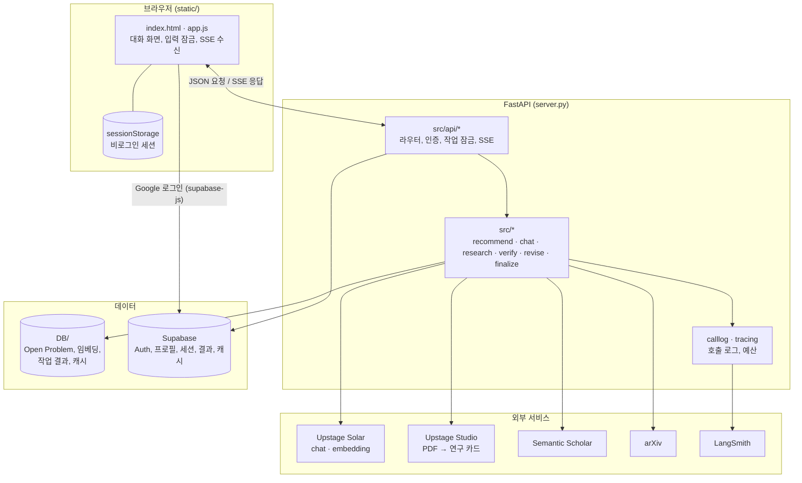

# 연구 주제 탐색 에이전트

연구실 정보와 관심사를 입력하면, 서베이 논문의 Open Problem에서 출발해 **기존 연구와 겹치지 않는 새 연구 주제 후보**를 찾아 주는 대화형 서비스입니다.

- **배포:** https://llmops-paper-subject-searching-agnet.onrender.com
- **모델:** Upstage Solar (`solar-pro2`), Solar Embedding, Upstage Studio 에이전트
- **논문 검색:** Semantic Scholar Graph API, arXiv

## 목차

1. [서비스 소개](#1-서비스-소개)
2. [아키텍처](#2-아키텍처)
3. [실행 방법](#3-실행-방법)
4. [API](#4-api)
5. [관련 문서](#5-관련-문서)

## 1. 서비스 소개

### 해결하려는 문제

새 연구 주제를 찾으려면 분야의 미해결 문제를 알아야 하고, 떠올린 아이디어가 이미 나온 연구인지도 확인해야 합니다. 이 서비스는 그 과정을 다섯 단계의 대화로 안내합니다.

### 사용 흐름

화면은 ChatGPT처럼 하나의 대화입니다. 각 단계의 결과가 카드 메시지로 쌓이고, 사용자는 카드의 버튼이나 채팅으로 다음 단계로 넘어갑니다.

| 단계 | 사용자가 하는 일 | 서비스가 하는 일 |
|---|---|---|
| ① 둘러보기 | 연구실 이름, 연구 주제, 관심사 입력 | 서베이 논문에서 뽑아 둔 Open Problem 중 프로필에 맞는 것을 추천. 원문 인용과 출처를 함께 보여 줌 |
| ② 문제 파고들기 | 문제 하나를 고르고 대화로 조건 추가 (예: "GPU는 2장뿐") | 질문에 답하고, 필요하면 Semantic Scholar에서 논문을 찾아 근거로 붙임 |
| ③ 주제 다듬기 | "후보 만들기" | 참고문헌을 모으고, 여러 관점의 에이전트가 제안·상호 검토·토너먼트를 거쳐 후보 3개를 선별. 대화로 후보를 고칠 수 있음 |
| ④ 검증 | 후보 하나를 골라 "이 후보 검증" | 관련 논문을 찾아 문제·방법·가정·평가 네 요소로 비교하고, 이미 풀렸는지(`solved` · `partial` · `not_addressed`) 판정. 비평도 함께 제공 |
| ⑤ 확정 | "이 주제로 확정" | 앞 단계 결과로 최종 주제 카드를 만들고 Markdown으로 내보냄 |

### 특징

- **근거를 지어내지 않습니다.** 카드의 인용문과 논문 정보는 LLM 출력이 아니라 DB와 원문에서 가져오고, LLM이 인용한 문장은 코드가 원문과 대조합니다. 대조에 실패한 항목은 버립니다.
- **판정은 코드가 내립니다.** LLM에게 "중복이냐"를 묻지 않습니다. Solar는 요소별로 비교만 하고, 점수 합산과 최종 판정은 같은 입력이면 같은 결과가 나오는 코드가 맡습니다.
- **로그인 없이 쓸 수 있습니다.** 비로그인 사용자의 세션은 브라우저 탭(sessionStorage)에만 남습니다. Google 로그인을 하면 세션이 서버에 저장되고, 로그인 전 세션을 계정으로 옮길 수 있습니다.
- **진행 상황을 실시간으로 보여 줍니다.** 오래 걸리는 작업은 SSE로 단계별 진행과 답변 조각을 보내고, 다른 세션으로 이동하면 작업을 취소합니다.
- **LLMOps:** 모든 외부 호출을 로그로 남기고(프롬프트 해시, 토큰, 지연 시간), 작업별 호출 예산을 넘으면 멈춥니다. LangSmith 추적과 사용자 피드백(👍/👎) 연결을 지원합니다.

## 2. 아키텍처

### 전체 구성



### 역할 분담

원칙은 **Studio는 읽고, Solar는 비교하고, 코드가 판정한다**입니다.

| 담당 | 하는 일 |
|---|---|
| Upstage Studio 에이전트 A | 서베이 PDF → Open Problem 추출 (오프라인 DB 구축) |
| Upstage Studio 에이전트 B | 논문 PDF → 본문 연구 카드 (④ 검증) |
| Solar chat | 검색어 작성, 추천 이유, 후보 생성, 요소별 비교, 비평, 대화 |
| Solar embedding | Open Problem 검색, 검증할 논문 좁히기 |
| Semantic Scholar · arXiv | 논문 검색, 초록, 오픈액세스 PDF |
| 코드 | 인용 대조, 점수 합산, 판정, 호출 예산, 캐시 |
| Supabase | Google 로그인, 사용자 데이터·작업 결과·캐시 저장 |

### 단계별 처리

**① 추천 (`src/recommend.py`)**

```text
프로필 → 검색어 작성(Solar) → 임베딩 검색(DB/embeddings.npy) → 문제 선택(Solar)
      → problem_id 검증(코드) → 추천 이유 작성(Solar)
```

추천 대상은 서베이 논문 5편에서 추출한 Open Problem 146개(`DB/all.json`)입니다. 화면의 제목·인용·출처는 DB 값을 그대로 씁니다.

**③ 후보 생성 (`src/research.py`, `src/references.py`, `src/multi_agent.py`)**

```text
참고문헌 검색 에이전트: 프로필 + 대화 + 고른 문제 → 검색어(최대 5개) → S2 → 초록 있는 논문 최대 40편
후보 생성 에이전트들:  4개 관점 × 3개 제안 = 12개 → 상호 검토와 수정 → 스위스 토너먼트 → 후보 3개
대화 에이전트:         후보와 참고문헌을 한국어로 설명
```

네 관점은 공통 가정 재검토(`assumption`), 다른 연구의 방법 전이(`transfer`), 실증 측정(`empirical`), 형식화(`formal`)입니다. 요청당 Solar 호출은 250회로 제한합니다.

**④ 검증 (`src/verify.py`, `src/cards.py`, `src/studio.py`)**

```text
V1 검색어 3개(Solar) → V2 S2 검색 + ③ 참고문헌 → V3 임베딩 유사도 상위 15편
→ V4 초록 연구 카드(Solar) → V5 요소별 비교, 최근접 3편
→ V6 본문 연구 카드(Studio B, PDF가 없으면 초록 카드 유지) → V7 다시 비교
→ V8 판정(코드) → V9 비평(Solar)
```

연구 카드는 문제·방법·가정·평가·한계 다섯 필드에 원문 인용을 붙인 형식이며, 같은 논문의 카드는 캐시해 다시 만들지 않습니다. 호출 한도는 Solar 50회, S2 15회, Studio 3회입니다.

**⑤ 확정 (`src/finalize.py`):** LLM을 부르지 않고 저장된 ①·③·④ 결과로 최종 카드를 조립합니다.

### 폴더 구조

```text
.
├─ server.py               FastAPI 진입점. src/api/의 라우터를 자동 등록하고 static/을 제공
├─ src/
│  ├─ api/                 기능별 라우터와 SSE 도우미(sse.py)
│  ├─ agents/tools/        LLM에 노출하는 Tool (search_papers, get_reference)
│  ├─ clients/             외부 API 호출 (Semantic Scholar, arXiv, 호출 대기열)
│  ├─ generation_method/   ③ 다중 에이전트 프롬프트와 설정
│  ├─ prompts/             단계별 프롬프트
│  ├─ recommend.py         ① 추천
│  ├─ chat.py              대화 (②~⑤ 공통)
│  ├─ conversation.py      대화 기록 정리와 압축
│  ├─ research.py          ③ 후보 생성
│  ├─ references.py        ③ 참고문헌 수집
│  ├─ multi_agent.py       ③ 제안 · 검토 · 토너먼트
│  ├─ revise.py            ③④ 후보 고치기
│  ├─ verify.py            ④ 검증
│  ├─ cards.py             ④ 연구 카드
│  ├─ studio.py            Upstage Studio 에이전트 호출
│  ├─ finalize.py          ⑤ 최종 카드
│  ├─ runs.py              작업 결과 저장 (run_id)
│  ├─ store.py             로그인 사용자 데이터 (Supabase 또는 로컬 폴더)
│  ├─ auth.py              Supabase 토큰 확인
│  ├─ calllog.py           호출 로그, 피드백
│  ├─ tracing.py           LangSmith 추적
│  ├─ extract.py, embed.py Open Problem DB 구축 스크립트
│  └─ llm.py, config.py    Solar 호출 래퍼, 설정
├─ static/                 화면 (index.html, app.js, modules/*.js)
├─ DB/                     Open Problem 데이터, 임베딩, 실행 중 생기는 결과·캐시·로그
├─ docs/                   요구사항, 설계서, API 명세, Supabase 스키마
├─ eval/                   검색 품질 평가
└─ tests/                  단위 테스트
```

### 데이터 저장

| 경로 | 내용 | Git |
|---|---|---|
| `DB/all.json` | 추천에 쓰는 Open Problem 통합 데이터 | 추적 |
| `DB/embeddings.npy`, `DB/embeddings.json` | Open Problem 임베딩과 메타데이터 | 추적 |
| `DB/runs/` | 비로그인 작업 결과. 24시간 뒤 삭제 | 제외 |
| `DB/users/` | Supabase가 없을 때의 로그인 사용자 데이터 | 제외 |
| `DB/abstract_cards/` | 초록 연구 카드 캐시 | 제외 |
| `DB/logs/calls-YYYYMMDD.jsonl` | 외부 호출 로그 | 제외 |
| `DB/feedback.jsonl` | 사용자 피드백 | 제외 |

Supabase를 설정하면 로그인 사용자의 프로필·세션·결과와 연구 카드 캐시를 Supabase 테이블(`docs/supabase.sql`)에 저장합니다. Render 디스크는 재배포 때 지워지므로 배포 환경에서는 Supabase가 원본입니다.

## 3. 실행 방법

### 준비

- Python 3.13
- Upstage API 키 (필수)
- Semantic Scholar API 키 (선택, 권장)

### 설치

```bash
git clone https://github.com/jinseok3639/LLMOps_Paper_subject_searching_Agnet.git
```

```bash
cd LLMOps_Paper_subject_searching_Agnet
```

```bash
python -m venv .venv
```

Windows는 `.venv\Scripts\activate`, macOS·Linux는 `source .venv/bin/activate`로 가상환경을 켭니다.

```bash
pip install -r requirements.txt
```

### 환경 변수

`.env.example`을 `.env`로 복사하고 값을 채웁니다. `.env`는 커밋하지 않습니다.

| 변수 | 필수 | 설명 |
|---|---|---|
| `UPSTAGE_API_KEY` | ● | Solar chat, embedding, Studio 호출 |
| `S2_API_KEY` | | Semantic Scholar 키. 없어도 동작하지만 호출 제한에 걸리기 쉬움 |
| `STUDIO_CARD_AGENT_ID` | | ④ 본문 연구 카드용 Studio 에이전트. 없으면 초록 카드만으로 검증 |
| `STUDIO_OP_AGENT_ID` | | 서베이 PDF → Open Problem 추출용 Studio 에이전트 (DB 구축) |
| `SUPABASE_URL`, `SUPABASE_ANON_KEY` | | Google 로그인. 없으면 로그인 버튼이 숨고 모두 비로그인으로 동작 |
| `SUPABASE_SERVICE_ROLE_KEY` | | 서버의 Supabase 테이블 접근. 없으면 `DB/users/`에 저장 |
| `LANGSMITH_TRACING`, `LANGSMITH_API_KEY`, `LANGSMITH_PROJECT` | | LangSmith 추적. `LANGSMITH_TRACING=true`이고 키가 있을 때만 보냄 |

Supabase를 쓰려면 `docs/supabase.sql`로 테이블을 만들고, Supabase Auth에 Google 제공자와 리디렉션 주소(예: `http://localhost:8000`)를 등록합니다.

### 서버 실행

```bash
python -m uvicorn server:app --port 8000
```

브라우저에서 http://localhost:8000 을 엽니다. 외부 API 호출 대기열이 프로세스 안에 있으므로 워커는 하나로 실행합니다.

### 배포 (Render)

`master`에 푸시하면 자동으로 배포됩니다. 시작 명령은 다음과 같고, 환경 변수는 Render 대시보드에 설정합니다.

```bash
uvicorn server:app --host 0.0.0.0 --port $PORT --workers 1
```

### 테스트

외부 API는 모의 처리하므로 키 없이 돌아갑니다.

```bash
python -m unittest discover -s tests -v
```

### Open Problem DB 다시 만들기

`DB/all.json`과 임베딩은 저장소에 포함되어 있어 보통은 다시 만들 필요가 없습니다. 원본 데이터가 바뀌었을 때만 실행합니다.

```bash
python -m src.extract
```

```bash
python -m src.embed
```

## 4. API

자세한 형식은 [docs/API_명세.md](docs/API_명세.md)에 있습니다.

### 공통 규칙

- **작업 API는 상태를 기억하지 않습니다.** 브라우저가 요청할 때마다 프로필과 대화를 보내므로 비로그인과 로그인 사용자가 같은 API를 씁니다.
- **결과는 `run_id`로 저장합니다.** 세션에는 `run_id`만 넣고, 다시 열 때 `/api/runs/{run_id}`로 불러옵니다.
- **인증:** 로그인 사용자는 `Authorization: Bearer <Supabase access token>` 헤더를 붙입니다. 헤더가 없으면 비로그인입니다.
- **오류 형식:** 모든 오류는 `{"error": {"code", "message", "retryable", ...}}`입니다.

| HTTP | `code` | 언제 |
|---|---|---|
| 401 | `unauthorized` | 로그인이 필요한 API를 비로그인으로 호출, 또는 토큰 만료 |
| 404 | `not_found` | 없는 세션 또는 `run_id` (보관 기간이 지난 경우 포함) |
| 409 | `job_running` | 같은 세션의 작업이 다른 탭에서 진행 중 |
| 409 | `version_conflict` | 세션 저장 시 다른 탭이 먼저 저장함. `error.current`에 최신 세션 |
| 422 | `validation_error` | 필수 항목 누락. `fields`에 항목 이름 |
| 502 | `upstream_failed` | Solar, Upstage, S2 호출 실패 (`retryable: true`) |

### 작업 API (SSE)

로그인 없이 쓸 수 있고, `text/event-stream`으로 응답합니다. 모든 요청에 `session_id`가 필요합니다.

| 메서드 | 경로 | 단계 | 주요 입력 | 결과 |
|---|---|---|---|---|
| POST | `/api/recommend` | ① 추천 | `profile`, `rejections`, `exclude` | `recommendations[]`, `intro`, `note` |
| POST | `/api/chat` | 대화 | `profile`, `picks`, `messages`, `message`, `stage`, `memo` | `content`, `tokens_in`, `compact` |
| POST | `/api/chat/compact` | 대화 압축 | `messages`, `memo` | `memo` |
| POST | `/api/research` | ③ 후보 생성 | `profile`, `problem_id`, `messages`, `memo` | `topics[]`, `presentation`, `references[]` |
| POST | `/api/revise` | ③④ 후보 고치기 | `profile`, `research_run_id`, `topic_id`, `revision_run_id`, `verify_run_id`, `messages` | `version`, `changes[]`, `topic`, `reason` |
| POST | `/api/verify` | ④ 검증 | `profile`, `research_run_id`, `topic_id`, `revision_run_id` | 판정, 최근접 논문 3편과 요소별 근거, 비평 |
| POST | `/api/finalize` | ⑤ 확정 | `research_run_id`, `topic_id`, `recommend_run_id`, `verify_run_id`, `revision_run_id` | `card`, `markdown` |

`profile`은 `{lab_name, lab_topics, interests}`이며 `lab_name`, `lab_topics`는 필수입니다. 결과에는 모두 `session_id`와 `run_id`가 붙습니다 (`/api/chat`, `/api/chat/compact` 제외).

**SSE 이벤트**

| 이벤트 | 데이터 | 용도 |
|---|---|---|
| `progress` | `{session_id, step, message, current?, total?}` | 단계 진행 표시 |
| `delta` | `{session_id, text}` | 답변 스트리밍 조각 |
| `result` | `{session_id, ...결과}` | 성공. 마지막 이벤트 |
| `error` | `{session_id, error}` | 실패. 마지막 이벤트 |
| `budget` | `{session_id, used, limit, scope}` | 호출 예산 초과로 멈춤. 마지막 이벤트 |

```text
event: progress
data: {"session_id":"s_8f3a","step":"search","message":"참고문헌 검색: backdoor detection LLM agents","current":2,"total":5}

event: result
data: {"session_id":"s_8f3a","run_id":"r_9c8d", ...}
```

취소 API는 따로 없습니다. 브라우저가 연결을 끊으면 서버는 다음 단계에 들어가기 전에 멈춥니다.

### 인증

| 메서드 | 경로 | 설명 |
|---|---|---|
| GET | `/api/config` | 화면이 쓸 공개 설정 `{supabase_url, supabase_anon_key}` |
| GET | `/api/me` | `{user: {id, email, name} \| null}` |
| DELETE | `/api/me` | 계정과 모든 데이터 삭제 |

로그인과 로그아웃은 브라우저의 supabase-js가 처리하며, 서버에는 로그인 경로가 없습니다.

### 프로필과 세션 (로그인 필요)

| 메서드 | 경로 | 요청 | 응답 |
|---|---|---|---|
| GET | `/api/profile` | | 프로필 또는 `null` |
| PUT | `/api/profile` | 프로필 | 저장된 프로필 |
| GET | `/api/sessions` | | `[{id, title, stage, updated_at}]` (최근 순) |
| GET | `/api/sessions/{id}` | | 세션 전체 |
| PUT | `/api/sessions/{id}` | `{session, base_updated_at}` | 저장된 세션. 없으면 새로 만듦 |
| DELETE | `/api/sessions/{id}` | | 204. 세션의 작업 결과도 삭제 |
| POST | `/api/sessions/import` | `{sessions: [...]}` | `{imported: [{old_id, new_id}]}` (비로그인 세션을 계정으로 옮김) |

세션 id는 화면이 만들고(`s_` + 16진수), 처음 저장할 때는 `base_updated_at`을 `null`로 보냅니다.

### 결과 조회와 피드백

| 메서드 | 경로 | 설명 |
|---|---|---|
| GET | `/api/runs/{run_id}` | 저장된 작업 결과 전체 (추적 정보, 초록 포함) |
| POST | `/api/feedback` | `{session_id, target: "problem" \| "topic" \| "final", target_id, value: "up" \| "down", comment?}` → 204 |

비로그인 결과는 만든 지 24시간 뒤 삭제하고, 로그인 사용자의 결과는 그 결과를 가리키는 세션이 있는 동안 유지합니다.

## 5. 관련 문서

| 문서 | 내용 |
|---|---|
| [docs/요구사항.md](docs/요구사항.md) | 기능 요구사항과 우선순위 |
| [docs/설계서.md](docs/설계서.md) | 역할 분담, 검증 상세, 판단 기준(J-1~J-8) |
| [docs/API_명세.md](docs/API_명세.md) | API 형식 전체 |
| [docs/topic_recommendation_workflow.md](docs/topic_recommendation_workflow.md) | 다섯 단계의 세부 흐름 |
| [docs/supabase.sql](docs/supabase.sql) | Supabase 테이블 |
| [WORKFLOW.md](WORKFLOW.md) | 화면 상태 전환, 에이전트 간 전달 흐름 |
| [INDEX.md](INDEX.md) | 레포 구조 목표안 |
